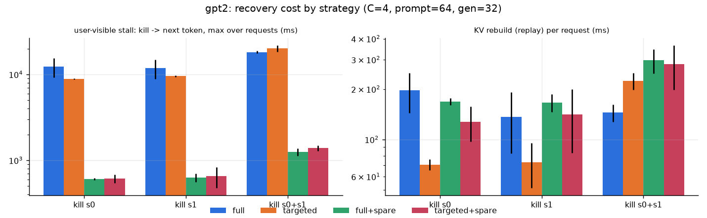
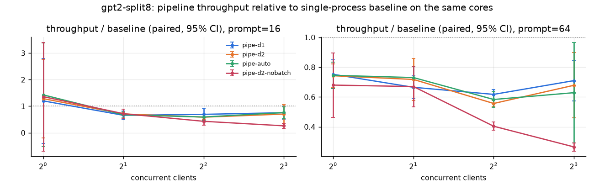
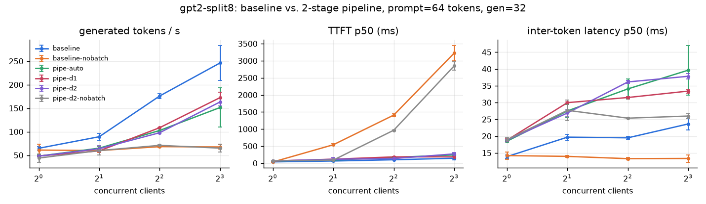
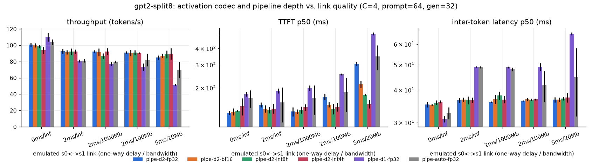
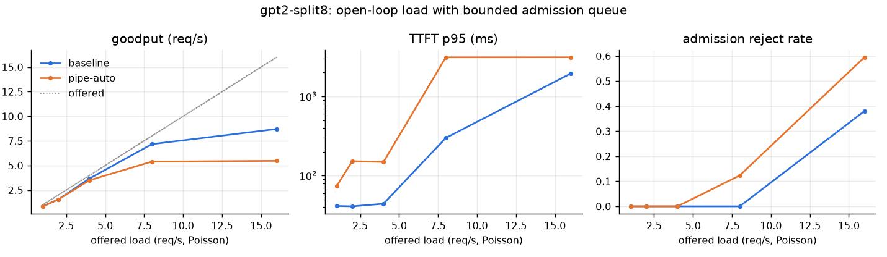
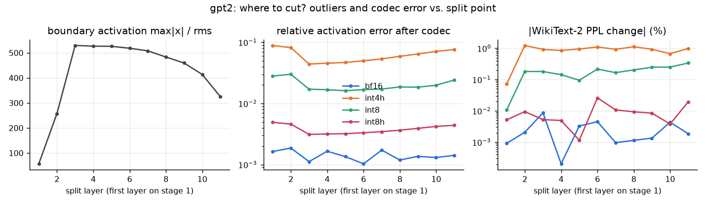

# Parallel LLM Inference over a Two-Stage gRPC Pipeline: Evaluation Report

Distributed Systems project, Topic 38, Team 62. All numbers come from scripts in `bench/` and the raw files
in `results/`. Figures are in `docs/figures/`.

## 1. Summary of findings

1. **Correctness holds under every injected fault.** The partitioned model reproduces the Hugging Face
   reference bit-for-bit (WikiText-2 perplexity 37.4033 vs. 37.4033 for GPT-2; 16.9895 vs. 16.9895 for
   Qwen2.5-0.5B). The full system reproduced greedy outputs token-for-token in all 60 worker-kill trials
   (240 requests; SIGKILL of s0, s1 or both; full or targeted recovery; with or without hot spares) and all
   25 lossy-reply trials (up to 20 % of replies dropped after the KV write). Across all of them there were
   zero duplicated tokens, zero out-of-order tokens and zero failed requests. When a stage is alive but too
   slow, the request **fails explicitly** after bounded retries.
2. **Recovery cost is dominated by bringing back the weights, not by rebuilding the KV cache.** Failure
   detection takes 45–130 ms and KV replay 70–300 ms, while a cold restart takes 8.5–19 s. A pre-loaded **hot
   spare** cuts the median user-visible stall from 9–19 s to 0.56–1.36 s (15–30×). **Targeted** recovery
   (rebuild only the failed stage) roughly halves replay time when stage 0 fails and sends no bytes over the
   inter-stage link.
3. **On one shared-memory host, pipelining does not beat a batched single process.** Measured: each stage
   runs at 8.7 ms/step alone but 12.5–13.7 ms when both run at once on *disjoint* pinned cores. With the
   split at layer 8, every decode step streams ≈ 227 MB of fp32 weights through stage 0 (8 layers × 28.3 MB)
   and ≈ 267 MB through stage 1 (4 layers + the 154 MB LM head), all ≫ 24 MB L3. That is ≈ 26–31 GB/s per
   stage, so the two stages compete for one memory bus. The batched baseline reaches 1.3–1.8× the pipeline's throughput at C ≥ 2. With batching
   disabled, true pipelining *does* help: depth-2 overlap is 1.08–1.23× the unbatched baseline at C = 2–8
   with 16-token prompts.
4. **Where pipelining clearly helps is when the link is slow, and that is where its design knobs matter.**
   With an emulated 5 ms / 20 Mbps link, overlapping two micro-batches (depth 2) gives 1.67× the throughput
   of depth 1. Adding the int4h activation codec (7.5× fewer bytes) brings it to 1.76× (90 vs. 51 tok/s) and
   halves TTFT relative to fp32 (152 vs. 310 ms). Our **adaptive depth policy** reaches 97 % of the better
   fixed depth on a fast link and 89–90 % on slow links. The wrong fixed choice costs up to 31 %.
5. **Activation compression: perplexity understates generation drift.** All codecs change WikiText-2 PPL by
   < 1 % and LAMBADA accuracy by ≤ 0.2 pt. Yet only fp32/fp16 keep 64/64 greedy continuations identical
   (bf16 63/64, int8h 54/64, plain int8 32/64, int4h 19/64). **Block-Hadamard rotation** removes the
   residual-stream outlier problem: plain int8 costs +0.26 % PPL, rotated int8 +0.012 %. fp16 is the
   sweet spot: 2× fewer bytes with no observed divergence.
6. **Pipelining's capacity benefit has to be engineered.** Naive "load then drop layers" left each Qwen
   worker at 0.96× the single-process RSS. Meta-device partial loading, tied-head co-location (LM head next
   to the embedding, a ring s0→s1→s0) and a memory-balanced cut bring the largest worker to **0.60×**.
   For the larger Qwen model the pipeline also reaches throughput parity at low concurrency (paired ratio
   1.04 / 0.96 at C = 1 / 4).
7. **Partitioning should be cost-balanced, not layer-balanced.** GPT-2's LM head costs as much as 4–5
   blocks during decode, so the naive cut at layer 6 leaves stage 1 64 % slower than stage 0. A profile-driven
   cut at layer 8 balances them (12.3 vs. 11.8 ms).

## 2. System under test

| | |
|---|---|
| Hardware | Intel Core i5-13500 (6 P-cores + 8 E-cores, 20 threads, 24 MB L3), 16 GB RAM, no GPU |
| Software | Windows 11, Python 3.11.9, PyTorch 2.14 (CPU), Transformers 5.x, grpcio 1.85 |
| Models | GPT-2 (124 M, 12 layers), Qwen2.5-0.5B (494 M, 24 layers, GQA, RoPE, tied embeddings) |
| Precision | fp32 weights and compute; codecs apply only to the inter-stage activation |
| Placement | coordinator, s0, s1 as separate OS processes on one host, loopback TCP. Perf runs are pinned: baseline on 6 physical P-cores with 6 threads; s0 and s1 on disjoint halves of the same 6 P-cores with 3 threads each; coordinator on E-cores |
| Decoding | deterministic greedy, `ignore_eos`, prompts of 16 or 64 real WikiText-2 tokens, 32 new tokens |

**Shared-host caveat.** An unrelated workload shared the machine (host CPU 25–40 % busy during runs, logged
per round as `host_cpu_pct`). Every perf experiment therefore uses **randomized, interleaved, paired rounds**:
all systems stay live and run back-to-back in a fresh random order per repeat, and ratios are computed
within a repeat. Absolute tok/s are conservative. Ratios are what we interpret.

## 3. Correctness

| check | result |
|---|---|
| split logits vs. HF, every split point (GPT-2: 11 splits; Qwen: 4) | max \|Δlogit\| < 5e-4 (fp32 re-association); exact for single-pass prefill |
| WikiText-2 PPL, split fp32 vs. HF | GPT-2 37.4033 = 37.4033; Qwen2.5-0.5B 16.9895 = 16.9895 |
| LAMBADA (first 1000) accuracy, split fp32 vs. HF | GPT-2 31.7 % = 31.7 % |
| greedy continuations (64 WikiText prompts × 32 tokens), split fp32 | 64/64 identical |
| end-to-end over gRPC vs. HF `generate` | identical (tests + every fault trial) |
| automated tests | 31 passing (`tests/`, `results/test_report.txt`), including six kill scenarios, lost replies, overload, stale epochs, timeouts and the ring placement |

## 4. Recovery (GPT-2, C = 4, prompt 64, gen 32, 5 trials per cell)

Medians; "stall" = kill → next token, max over the 4 in-flight requests. Raw data: `results/faults/kill_gpt2.csv`.

| strategy | killed | exact | detect ms | restart ms | KV replay ms / req | stall ms | replay link bytes |
|---|---|---|---|---|---|---|---|
| full | s0 | 20/20 | 48 | 13 270 | 219 | 13 787 | 976 kB |
| full | s1 | 20/20 | 53 | 9 220 | 114 | 10 089 | 1 631 kB |
| full | s0+s1 | 20/20 | 101 | 17 602 | 145 | 18 205 | 942 kB |
| targeted | s0 | 20/20 | 45 | 8 548 | **70** | 8 884 | **0** |
| targeted | s1 | 20/20 | 60 | 8 936 | 87 | 9 589 | 984 kB (no s0 recompute) |
| targeted | s0+s1 | 20/20 | 125 | 18 735 | 223 | 19 455 | 985 kB (falls back to full) |
| full + hot spare | s0 | 20/20 | 73 | **116** | 167 | **606** | 895 kB |
| full + hot spare | s1 | 20/20 | 59 | **118** | 162 | **618** | 966 kB |
| full + hot spare | s0+s1 | 20/20 | 127 | 320 | 301 | 1 198 | 950 kB |
| targeted + hot spare | s0 | 20/20 | 75 | 117 | 115 | 582 | 0 |
| targeted + hot spare | s1 | 20/20 | 65 | 117 | 120 | 560 | 950 kB |
| targeted + hot spare | s0+s1 | 20/20 | 110 | 576 | 270 | 1 361 | 971 kB |

Idempotent retries (`results/faults/lossy_gpt2.csv`): with 0 / 1 / 5 / 10 / 20 % of stage-0 replies dropped
*after* KV was written, all 20/20 requests per level are exact. Mean retries are 0 / 2 / 8 / 13 / 29 per run,
and throughput falls by at most 11 % (94.6 → 84.3 tok/s).

## 5. Performance

### 5.1 Concurrency sweep (pinned, equal cores, split 8)

Median tok/s over 4 paired repeats (`results/perf/concurrency_gpt2-split8.csv`):

| prompt | C | baseline | pipe depth 1 | pipe depth 2 | pipe auto | baseline no-batch | pipe d2 no-batch |
|---|---|---|---|---|---|---|---|
| 16 | 1 | 60 | 47 | 50 | 52 | 62 | 51 |
| 16 | 2 | 95 | 62 | 69 | 65 | 66 | 72 |
| 16 | 4 | 187 | 119 | 103 | 117 | 67 | 74 |
| 16 | 8 | 295 | 208 | 184 | 218 | 60 | 72 |
| 64 | 1 | 65 | 49 | 48 | 49 | 66 | 47 |
| 64 | 2 | 91 | 59 | 65 | 65 | 60 | 62 |
| 64 | 4 | 174 | 109 | 98 | 103 | 69 | 71 |
| 64 | 8 | 246 | 175 | 162 | 171 | 68 | 68 |

Paired throughput ratio pipe / baseline (mean of per-repeat ratios) is 0.56–0.76 at C ≥ 2 for every depth
policy. Unbatched, it is 1.08 / 1.17 / 1.23 (C = 2 / 4 / 8, 16-token prompts). Per-step overhead
attribution at C = 1 (from per-hop timestamps): coordinator↔s0 ≈ 1.4 ms, s0↔s1 ≈ 1.7 ms, handler glue
≈ 0.4 ms, so about 3.5 ms of RPC overhead on a ~19 ms step. Bytes per generated token (prompt 64, fp32):
9 120 B activation payload (prefill amortized), 30–78 B link control, 140–310 B coordinator traffic.

**Why the pipeline loses here (memory-bandwidth contention).** `python -m bench.contention`: stage 0 (layers
0–7) and stage 1 (8–11 + head) pinned to {0,2,4} and {6,8,10} run at 8.72 / 8.78 ms/step alone and at
13.70 / 12.53 ms/step concurrently, a 45–55 % slowdown with no shared cores. Decode is weight-streaming
bound, so splitting it into smaller overlapped micro-batches streams the weights *more* often per token,
and the two stages compete for one DRAM interface. Batching amortizes the streaming, which is why the
batched baseline wins and depth-2 micro-batching can even lose to depth 1. On two separate nodes each
stage gets its own memory bus. That is the setting pipelining is designed for, and the network experiment
below isolates its link-side half.

### 5.2 Link quality × codec × depth (C = 4, prompt 64)

Mean tok/s over 4 paired repeats (`results/perf/network_gpt2-split8.csv`):

| link (one-way delay / bw) | d2 fp32 | d2 bf16 | d2 int8h | d2 int4h | d1 fp32 | TTFT p50 d2 fp32 → int4h |
|---|---|---|---|---|---|---|
| 0 ms / ∞ | 101 | 100 | 98 | 94 | **110** | 130 → 135 ms |
| 2 ms / ∞ | **93** | 91 | 92 | 92 | 81 | 148 → 139 ms |
| 2 ms / 1 Gb | **92** | 91 | 87 | 92 | 77 | 128 → 140 ms |
| 2 ms / 100 Mb | **91** | 91 | 91 | 91 | 73 | 174 → 147 ms |
| 5 ms / 20 Mb | 85 | 87 | 89 | **90** | 51 | 310 → **152 ms** |

Adaptive depth policy, separate paired run (`results/perf_auto/network_gpt2-split8.csv`, mean ± sd of 4):

| link | depth 1 | depth 2 | auto | auto / best fixed |
|---|---|---|---|---|
| 0 ms / ∞ | 108.7 ± 0.5 | 96.1 ± 4.6 | 105.8 ± 4.0 | 97 % |
| 2 ms / ∞ | 61.8 ± 1.7 | 89.9 ± 5.3 | 81.1 ± 11.4 | 90 % |
| 5 ms / 20 Mb | 51.1 ± 1.6 | 74.0 ± 9.5 | 65.5 ± 10.6 | 89 % |

* Depth-2 overlap hides link latency: +15 % at 2 ms and +67 % at 5 ms / 20 Mb vs. depth 1 (fp32).
* Compression only matters once bandwidth binds: at 20 Mb, int4h adds +6 % throughput and **halves TTFT**
  (152 vs. 310 ms) because prefill activations dominate the bytes. On a fast link codecs cost a little
  (encode/decode CPU).
* The adaptive policy never settles on the worse arm. The remaining gap to the oracle is exploration cost
  plus noise in 0.5 s measurement windows.

### 5.3 Open-loop load and backpressure (Poisson arrivals, `max_waiting` = 16)

| offered req/s | baseline goodput | baseline reject | baseline TTFT p95 | pipe goodput | pipe reject | pipe TTFT p95 |
|---|---|---|---|---|---|---|
| 1 | 0.84 | 0 | 41 ms | 0.84 | 0 | 74 ms |
| 4 | 3.67 | 0 | 44 ms | 3.50 | 0 | 148 ms |
| 8 | 7.17 | 0 | 299 ms | 5.39 | 12 % | 3.1 s |
| 16 | 8.70 | 38 % | 1.9 s | 5.47 | 59 % | 3.1 s |

Past saturation the bounded admission queue sheds load explicitly and TTFT p95 plateaus instead of
growing without bound.

## 6. Activation compression and where to cut

| codec | bytes/token (H=768) | WikiText-2 PPL Δ | LAMBADA | greedy exact (64) | token agreement |
|---|---|---|---|---|---|
| fp32 | 3 072 | 0 | 31.7 % | 64 | 100 % |
| fp16 | 1 536 | +0.0002 % | 31.7 % | 64 | 100 % |
| bf16 | 1 536 | +0.003 % | 31.7 % | 63 | 99.7 % |
| int8 (per-token) | 770 | +0.26 % | 31.9 % | 32 | 70.0 % |
| int8h (Hadamard) | 792 | +0.012 % | 31.7 % | 54 | 91.2 % |
| int4h (Hadamard) | 408 | +0.90 % | 31.6 % | 19 | 58.6 % |

**Split sweep** (`results/accuracy/sweep_gpt2.csv`). The boundary activation's max/rms ratio jumps from 57
after layer 1 to ~530 after layer 3. These are GPT-2's massive residual-stream channels (138, 378, 447).
They triple per-token int8's error, while the Hadamard codecs stay flat across split points (int8h ≤ +0.03 %
at every cut). Cutting after layer 1 is cheapest for any codec, but it is far from cost-balanced.

**Negative result.** Extracting the top-k outlier channels to fp16 on top of Hadamard reduced activation
error by only 20–25 % (k = 8–16). After rotation, the error is dominated by uniform quantization noise rather
than outliers, so we did not ship it.

## 6b. A larger, Llama-style model: Qwen2.5-0.5B

24 layers, GQA (14 query / 2 KV heads), RoPE, SwiGLU, tied 151 936 × 896 embedding. Same code path
(`ArchSpec.family = "qwen2"`).

**Quality** (`results/accuracy/*_Qwen2.5-0.5B.csv`; WikiText-2 32 k tokens, LAMBADA first 500, 32 greedy prompts):

| codec | PPL Δ | LAMBADA | greedy exact (32) | token agreement |
|---|---|---|---|---|
| fp32 | 0 (16.9895 = HF) | 51.8 % (= HF) | 32 | 100 % |
| fp16 | −0.0001 % | 51.8 % | 32 | 100 % |
| bf16 | +0.001 % | 52.0 % | 31 | 99.7 % |
| int8 (per-token) | **+1.89 %** | 52.0 % | **8** | 51.2 % |
| int8h (Hadamard) | **−0.002 %** | 52.4 % | **30** | 96.4 % |
| int4h (Hadamard) | +1.98 % | 51.4 % | 5 | 44.2 % |

Outliers matter even more here. Qwen's boundary max/rms is 18 after layers 1–2, jumps to ~650 from layer 3
through 20, then falls back to ~27 near the top (`sweep_Qwen2.5-0.5B.csv`). Per-token int8 costs +2.2 % PPL
at cuts 4–8 but only +0.03–0.05 % at cuts 1–2. Hadamard int8 stays within ±0.08 % at **every** cut. Rotation
turns int8 from unusable into lossless-in-practice for Llama-style models.

**Performance** (pinned, equal cores, balanced split 15: per-block decode ≈ 3.6 ms, head ≈ 20 ms;
`results/perf/concurrency_Qwen2.5-0.5B-split15.csv`):

| C | baseline tok/s | pipe d1 | pipe d2 | pipe / baseline (d1, paired) |
|---|---|---|---|---|
| 1 | 12.8 | 13.4 | 11.8 | 1.04 ± 0.06 |
| 4 | 32.2 | 32.2 | 17.5 | 0.96 ± 0.09 |
| 8 | 54.4 | 47.1 | 43.3 | 0.86 ± 0.08 |

With ~4× more compute per step than GPT-2, the fixed RPC cost (~3.5 ms) becomes small and the pipeline
**reaches parity** with the single process at low concurrency (vs. 0.62–0.75 for GPT-2). For the same reason,
an emulated 5 ms / 20 Mb link costs Qwen ~27 % throughput regardless of depth (25.7 vs. 35.1 tok/s for depth 1). A step is
~100 ms of compute, so overlap has little latency to hide. TTFT still benefits from int8h on the slow link
(664 vs. 756 ms).

**Adaptive depth on a slow model.** With ~100 ms steps, a 0.5 s measurement window held only ~5 steps and
`auto` reached just 0.75× baseline at C = 4. We now close a window only after ≥ 32 sequence-steps
(`auto_min_ops`). In a re-run (`results/perf_auto/concurrency_Qwen2.5-0.5B-split15.csv`, 3 paired repeats),
every logged decision picks the better arm (e.g. d1 31.1 vs. d2 23.9 seq-steps/s), and auto's ratio rises to
0.86 at C = 4 (d1 0.93, d2 0.73). The remaining gap is exploration cost in rounds of only ~4 s.

## 6c. Memory: making pipelining pay off in capacity

`results/memory.csv`. RSS after one generation; the baseline is one process holding the whole model.

| model | placement | split | weights s0 / s1 (MB) | RSS s0 / s1 (MB) | baseline RSS | largest worker / baseline |
|---|---|---|---|---|---|---|
| GPT-2 | head on last | 6 | 328 / 325 | 651 / 798 | 992 | 0.80 |
| GPT-2 | head on first (ring) | 6 | 328 / 170 | 800 / 649 | 992 | 0.81 |
| Qwen2.5-0.5B | head on last | 12 | 1 260 / 1 260 | 1 752 / 1 745 | 2 527 | 0.69 |
| Qwen2.5-0.5B | head on first (ring) | 12 | 1 260 / 716 | 1 744 / 1 206 | 2 527 | 0.69 |
| Qwen2.5-0.5B | ring, memory-balanced | 7 | 962 / 1 014 | 1 444 / 1 506 | 2 527 | **0.60** |

Two design fixes were needed before splitting the model actually halved the weights per process:

1. **Partial loading** (`pllm.model.load_partial`). The model skeleton is built on the `meta` device and only
   the stage's own tensors are read from the safetensors file. Loading the full model and dropping layers
   left RSS at 0.96× the baseline for Qwen, because the freed memory was not returned to the OS.
2. **Tied-head co-location (ring placement, `--head-on-first`).** With tied embeddings, "embedding on s0,
   head on s1" stores the vocab matrix twice (545 MB for Qwen). Putting the head next to the embedding on
   s0 (s1 returns final hidden rows, 896 floats per token) stores it once. Combined with a cut chosen to
   balance *memory*, the largest worker needs 60 % of the single-process footprint. The remaining overhead
   is ~480 MB of Python/PyTorch runtime per process.

The ring placement is covered by tests: bit-exact logits for both models, and end-to-end exact outputs
across an s1 kill.

## 7. Design decisions that mattered (and what we changed after measuring)

| observation | change |
|---|---|
| depth-2 scheduling packed all 4 requests into one micro-batch, so stage 0 sat idle | micro-batch size capped at ⌈runnable / depth⌉ |
| naive n/2 split: s1 64 % slower than s0 (LM head) | `pllm/balance.py` profiles blocks and head, picks argmin max(stage) |
| unpinned workers on a hybrid CPU: stage time ±2× run to run | CPU-set pinning for every process; same physical cores for baseline and pipeline |
| a restarted peer stayed unreachable for seconds (gRPC reconnect backoff grows to 120 s) | backoff capped at 1 s; exponential backoff between recovery attempts |
| auto depth mis-chose depth 1 on slow links (first window included the prefill burst) | metric = sequence-steps/s, A/B/A/B sampling, discard windows with admissions |
| orphaned workers after a crashed test run exhausted RAM | `--parent-pid` watchdog: workers exit when their supervisor dies |
| grpc.aio poller bound to a closed event loop stalled the test suite | one event loop per process (tests and benchmarks) |
| workers used 0.96× baseline memory despite holding half the layers | meta-device partial loading + tied-head ring placement + memory-balanced cut (0.60×) |
| auto depth too noisy for slow (~100 ms/step) models | windows close on time **and** ≥ 32 sequence-steps |

## 8. Threats to validity

* Single host. Real two-node runs (RCE) were not available. The netem-style delay and bandwidth emulation
  sits in the s0↔s1 path and models latency and serialization, not kernel/NIC overheads or jitter.
* Background load from an unrelated workload. This is mitigated by paired, interleaved rounds and logged
  host CPU, but absolute numbers vary by ±15–25 % between repeats.
* CPU-only fp32. On GPUs the compute/communication balance shifts and codec costs differ.
* Small models. They make RPC overhead relatively large. Larger models favour pipelining (more compute per
  byte of activation).

## 9. Related work used

Orca (selective batching, iteration-level scheduling; OSDI'22) · Sarathi-Serve (chunked prefill, stall-free
batches; OSDI'24, arXiv 2403.02310) · GPipe (micro-batch pipelining; arXiv 1811.06965) · Petals (client-side
input caching for server failover; arXiv 2209.01188, 2312.08361) · DéjàVu (KV-cache streaming and fast
recovery for pipeline-parallel serving; ICML'24, arXiv 2403.01876) · FailSafe (resilient serving; arXiv
2511.14116) · LLM.int8() (outlier channels; arXiv 2208.07339) · QuaRot (Hadamard rotation for outlier-free
quantization; arXiv 2404.00456) · TAH-Quant (activation quantization for pipeline links; arXiv 2506.01352).
